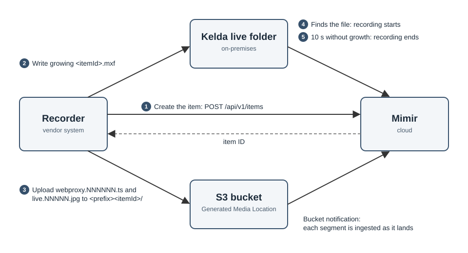

# Integrating a Live Recorder with Mimir

How a third-party live recording system delivers recordings into Mimir using
Mimir's existing APIs and ingest workflows.

This repository holds the guide below and [a small runnable example](#the-example)
of the recorder side, which follows the guide step by step.

## Summary

A live recording system (the recorder) can start recordings on its own and have
them appear in Mimir as live assets, without using Mimir's recording scheduler
and without vendor-specific code in Mimir. The recorder creates a Mimir item
through the public REST API when a recording starts, then writes its media under
that item's ID: a growing high-res file into an on-premises folder that Mimir's
on-premises agent Kelda watches, and proxy segments and thumbnails into an S3
bucket. Mimir detects the media, puts the item into recording state, makes it
playable and editable while it records, and completes it when the high-res file
stops growing.

This guide covers recorder-initiated recordings: the flow to use when the
recorder or a third-party system manages the ingest schedule. It describes the
workflow first, then the media delivery contract the recorder must follow.

## Components and responsibilities

| Component | Owner | Role |
| --- | --- | --- |
| Mimir (cloud) | Mimir | Items (assets), metadata, S3 segment ingest, playback, editing, render and conform, REST API and webhooks. |
| Kelda (on-premises) | Mimir | Runs next to the recorder. Watches live folders for growing high-res files and links them to items. |
| Recorder | Recorder vendor | Records, encodes and writes the media files. Calls the Mimir REST API to create items. |
| Customer systems | Customer or integrator | Optional. Can add metadata to recordings through the REST API. |
| Storage | Customer | An S3 bucket registered in Mimir as a Generated Media Location, and on-premises storage mounted into Kelda as live folders and the primary root. |

## One-time setup

A Mimir administrator usually does this in System Settings:

- **Generated Media Location:** the S3 bucket and path prefix the recorder
  writes segments to. Register it with `autoCreateItems: false`, so each folder
  name is read as a Mimir item ID. Mimir's in-app setup guide prints the bucket
  CORS rules, the IAM role trust policy and the permissions policy to apply.
  With role-based access, Mimir never holds long-lived bucket credentials. Note
  the location's ID; the recorder needs it.
- **Live folder:** a folder on the on-premises storage, configured as a Kelda
  live folder (it appears inside Kelda under `/kelda/kelda-root/livefolders/`).
  Its file extension list must include the recorder's container, typically
  `.mxf`. When the recorder delivers its own proxy and thumbnails to S3, turn on
  "Externally generated web proxy and thumbnails"; when Kelda should make the
  proxy from the high-res, leave it off. Kelda scans live folders every 30
  seconds by default, and treats a file as finished after 10 seconds without
  growth (the live stability threshold in the Kelda configuration, which is
  separate from its general stability threshold); both are configurable.
- **API key:** a Mimir user and API key for the recorder. It needs permission to
  create items. Every call sends it in the header
  `x-mimir-cognito-id-token: Bearer <key>`.

## Workflow

The recorder decides when to record, for example when an operator presses
record. Mimir's scheduler is not involved, and Mimir never calls the recorder.
The recorder needs to make one API call per recording; everything else is files.



1. The recording starts on the recorder. Before writing any media, the recorder
   creates the Mimir item:

   ```http
   POST /api/v1/items
   x-mimir-cognito-id-token: Bearer <key>
   Content-Type: application/json

   {
     "itemType": "video",
     "title": "Studio 3 live 2026-11-18 14:00",
     "folderParents": ["<Mimir folder id>"],
     "metadata": { "formId": "<metadata form id>", "formData": { "title": "...", "...": "..." } },
     "enabledStreams": ["lrwt"],
     "generatedMediaLocationId": "<Generated Media Location id>"
   }
   ```

   The response's `id` is the Mimir item ID. `enabledStreams: ["lrwt"]` says
   that a proxy TS stream will arrive in S3, and makes the item a live item that
   accepts segments. `generatedMediaLocationId` must be at the top level of the
   create request; a nested form is ignored and binds the item to Mimir's own
   bucket instead. `folderParents` and `metadata` are optional.
2. The recorder writes the high-res as a growing file named after the item ID
   into the live folder: `<itemId>.mxf`.
3. The recorder writes proxy segments and thumbnails into S3 under the item ID:
   `s3://<bucket>/<pathPrefix><itemId>/webproxy.000000.ts`, `live.00000.jpg`
   and so on (see [Media delivery contract](#media-delivery-contract)).
4. Mimir starts the recording. On its next scan, Kelda finds the growing file
   and matches it to the item by file name. Because the item expects streams but
   has no recording yet, Mimir sets it to recording state
   (`direct_S3_recording`), starts tracking it, and marks it as streaming. The
   recording is then visible in Mimir and can be played and edited while it
   records. Proxy segments that reached S3 before this point are already counted
   and play as normal.
5. The recording ends when the high-res file has not grown for 10 seconds. Kelda
   then stops the recording: the item is set to `resources_deleted` and
   `COMPLETE`, streaming ends, Kelda links the high-res into the primary root
   (and uploads or archives it if the live folder is set up for that), and Mimir
   runs any analysis enabled on the item, such as transcription.

A recording that Kelda has not ended and that receives no new S3 segments for
60 minutes is marked as stalled: streaming ends and the item is set to error
with the message "Live streaming has stalled".

## Rules the recorder must follow

- Create the item before writing the first byte of media. The ID is part of
  every file name. If Kelda sees the high-res file before the item exists, or
  the file has any other name, Kelda creates a separate item from the file and
  the recording is split across two assets. With the external proxy setting on,
  that extra item has no proxy.
- Write the high-res file without pauses longer than the stability threshold
  (10 seconds by default), or Kelda ends the recording early.
- Use the same item ID for the S3 folder and the high-res file name.
- Follow the segment and thumbnail rules under
  [Media delivery contract](#media-delivery-contract) exactly. Wrongly named
  files are ignored.

## Metadata and timecode

- Descriptive metadata goes in the create request, or can be added at any time
  later with `PATCH /api/v1/itemMetadata/{itemId}`. Customer systems can enrich
  a recording this way after the recorder has created it.
- Technical metadata is read by Mimir from the media.
- Sidecar files in the S3 folder are not applied to items created through the
  API. Use the API for metadata.

## Variants

- **Kelda makes the proxy:** create the item without `enabledStreams` and
  `generatedMediaLocationId`, write only `<itemId>.mxf`, and use a live folder
  with the external proxy setting off. Kelda encodes the proxy and thumbnails
  from the high-res.
- **No API calls at all:** write a high-res file with any name into a live
  folder with the external proxy setting off. Kelda creates an item from the
  file, titled after the file name, and makes the proxy. Metadata can be given
  in a sidecar file next to the media file. Alternatively, write segments into a
  Generated Media Location registered with `autoCreateItems: true`: each new
  folder becomes a new item, titled after the folder name, and the recording
  counts as ended 30 to 90 seconds after the last TS segment. A `sidecar.json`
  or `metadata.xml` written in the first minute sets metadata, target folder and
  timecode. In both cases the recorder never learns the item ID, so another
  system must find the item through search.

## Media delivery contract

### S3 segments and thumbnails

Write every file for a recording into one folder named after the Mimir item ID,
directly under the Generated Media Location's path prefix:

```
s3://<bucket>/<pathPrefix><itemId>/<file name>
```

Only one folder level is allowed. Mimir drops files for an item that is not a
live item. File names must follow this pattern exactly; any other name is
ignored, and a wrongly named `.ts` file also adds a warning to the item.

| Stream | File name | Numbering |
| --- | --- | --- |
| Proxy video | `webproxy.NNNNNN.ts` | Starts at 0, padded to 6 digits |
| Thumbnail | `live.NNNNN.jpg` | One per second, padded to 5 digits; index = seconds from start |

Segment requirements Mimir checks or relies on:

- **Container:** MPEG-2 transport stream. The size must be a whole number of
  188-byte packets, every packet must start with the sync byte, and a PMT must
  be present.
- **Video:** H.264 only (stream type `0x1B`). HEVC and other codecs are ignored,
  so a segment without H.264 video is rejected. Every segment must start with a
  keyframe, and the GOP should be closed and aligned to segment boundaries.
- **Audio:** AAC in ADTS (stream type `0x0F`). Several audio PIDs are supported,
  for example eight mono tracks. All audio PIDs in a segment must start and end
  on the same timestamps. The sample rate must stay constant.
- **Duration:** every segment in a stream must have the same duration; Mimir
  places segment N at N times that duration. 2 seconds is recommended, and 2 to
  10 seconds is the documented range.
- **Segment 0** sets the recording's time base. If segment 0 is invalid, the
  whole recording fails. Until segment 0 arrives, the item does not start
  streaming.
- **Order:** segments may arrive out of order and late segments are accepted. A
  permanent gap ends waveform and caption processing at the gap, so resend
  missing segments rather than skip them.
- **Thumbnails:** JPEG, 320x180, one per second. The first must be named
  exactly `live.00000.jpg`; later ones are read from the bucket by index.

Write `webproxy` segments and `live` thumbnails; the high-res arrives as the
growing file. An optional `transcript.json` in the same folder is loaded as
the item's transcript and replaced when written again.

### Growing high-res file

- **Name:** `<itemId>.<ext>`, written directly into the live folder. Kelda finds
  the item by the file name without its extension.
- Kelda reads the file while it grows. For MXF it builds an index as the file
  grows. Rewrap for Premiere and conform works only for AVC-Intra essence. The
  container must be readable by ffmpeg while it is being written, such as MXF
  OP1a with a growing body.
- The recording ends when the file has not grown for the stability threshold
  (10 seconds by default). There is no end marker. If the recorder rewrites the
  file footer when it closes the file, the live folder can be set to ignore a
  number of trailing bytes until the file stops growing.
- Afterwards Kelda hard-links or copies the file into the primary root under the
  item ID, uploads it if the live folder points high-res to cloud storage, and
  archives it if auto-archive is on.

### Recording states

| State | Meaning |
| --- | --- |
| `direct_S3_recording` | Recording; Mimir accepts segments for the item. |
| `resources_deleted` | Finished. The item is complete and behaves like any other asset. |
| `error` | The recording failed, for example at start or stop, or because segment 0 was invalid. The reason is on the item. |

The item's streaming flag is true while the recording is live. Item state can be
read with `GET /api/v1/items/{itemId}` or, once the item has a live state,
`GET /prime/api/v1/live/items/{itemId}`.

### Failure handling

- **Upload delays:** Mimir ingests each S3 segment when it lands, whatever the
  order or delay. If the recorder cannot reach S3, it should keep recording,
  buffer locally, and upload late segments under the same names.
- An invalid segment 0 fails the recording. Other bad segments are skipped and a
  warning is added to the item.
- If the item cannot be created because Mimir is unreachable, the recorder
  should retry before writing media under any name. A high-res file written
  under a different name becomes a separate item.

# The example

A small, complete implementation of the recorder side of the workflow above. A
real-time `ffmpeg` encode of a test signal stands in for the recorder's
encoders, so the whole flow runs end to end with a growing file.

## What it does

1. Creates the Mimir item with `POST /api/v1/items`, with
   `enabledStreams: ["lrwt"]` and a top-level `generatedMediaLocationId`.
2. Writes the high-res as a growing `<itemId>.mxf` (AVC-Intra 100, two mono PCM
   tracks) straight into a Kelda live folder.
3. Uploads 2-second H.264/AAC proxy segments (`webproxy.NNNNNN.ts`) and one
   320x180 thumbnail per second (`live.NNNNN.jpg`) to
   `s3://<bucket>/<pathPrefix><itemId>/` as each one is complete.

Nothing more is needed to end the recording: Kelda ends it about 10 seconds
after the file stops growing, and Mimir completes the item.

Mimir sends the recorder no confirmation for any of these steps. To see that
it handled the recording, look at the item in Mimir, or read it with
`GET /api/v1/items/{itemId}` (see [Checking the result](#checking-the-result)).

| File | Content |
| --- | --- |
| `src/main.ts` | The flow above, step by step. Start reading here. |
| `src/mimirApi.ts` | The one Mimir API call: creating the item. |
| `src/recording.ts` | Runs the encoder and uploads segments and thumbnails while it records. |
| `src/encoder.ts` | The `ffmpeg` command that stands in for the recorder's encoders. |
| `src/config.ts` | Reads the settings from `.env`. |

## What you need

- Node.js 24 or later (it runs the TypeScript sources directly) and `ffmpeg`
  with `libx264` on the `PATH`.
- In Mimir:
  - A Generated Media Location for your S3 bucket, registered with
    `autoCreateItems: false`.
  - A Kelda with a live folder that has "Externally generated web proxy and
    thumbnails" turned on and accepts `.mxf`. The example writes into that
    folder, so it must run where the folder is reachable as a local path.
  - An API key for a user that may create items.
- AWS credentials that may call `s3:PutObject` under the location's path prefix
  and `s3:HeadBucket` on the bucket.

## Running

```sh
npm install
cp .env.example .env    # then fill in the empty values
npm run record
```

All settings, including the Mimir API key and the AWS credentials, are in
`.env`; `.env.example` explains each one. A variable that is already set in the
shell takes precedence over the value in `.env`, which is handy for one-off
changes such as `RECORDING_SECONDS=20 npm run record`.

Exit codes: 0 when the recording was delivered, 1 when the run failed (for
example because the bucket or Mimir could not be reached), and 2 when the
configuration is incomplete. Exit code 0 means the files were written and
uploaded, not that Mimir recorded them; check that as below.

## Checking the result

While the example records, the item should show up in Mimir as recording and
be playable. Through the API:

```sh
set -a; . ./.env; set +a
curl -s "$MIMIR_BASE_URL/api/v1/items/<itemId>" \
  -H "x-mimir-cognito-id-token: Bearer $MIMIR_API_KEY" \
  | jq '{itemState, live: .liveRecording.state, streaming: .media.streaming,
         segments: .media.segmentCount, warnings, errors: .progressInfo.errors}'
```

During the recording, `live` is `direct_S3_recording` and `streaming` is true.
About 10 to 15 seconds after the recording ends, `live` is `resources_deleted`,
`streaming` is false, `itemState` is `complete`, `segments` matches the number
the example uploaded, and there are no warnings or errors.

Mimir only treats the item as a live recording once Kelda has found the growing
file in its live folder. If `live` stays `null` while the segments count up,
Kelda is not watching that folder, or the folder is set up differently from
"What you need".

## Setting up a test environment

What the example needs, set up from scratch. The files that hold credentials
are ignored by git: `.env`, `config.json` (Kelda's config file, with its access
token) and `kelda/` (Kelda's working directories). The commands below read
their settings from `.env` after `set -a; . ./.env; set +a`.

### S3 bucket and IAM role

Create the bucket and an IAM role that Mimir assumes to read it. Mimir's in-app
setup guide for Generated Media Locations shows what to apply: the bucket's
CORS rules, the role's trust policy, which names Mimir's AWS account and an
external ID, and the role's permissions policy. The external ID is the Base64
form of `<tenantId>#<userId>` for the user the API key belongs to.

The recorder itself needs separate credentials that may call `s3:PutObject`
under the path prefix and `s3:HeadBucket` on the bucket; they go in `.env`.

### Generated Media Location

Register the bucket in Mimir, in System Settings or through the API with an
administrator's API key. The `externalId` must match the one in the trust
policy, or the call is rejected:

```sh
curl -X POST "$MIMIR_BASE_URL/ingest/api/v1/generatedMediaLocations" \
  -H "x-mimir-cognito-id-token: Bearer $MIMIR_API_KEY" \
  -H 'Content-Type: application/json' \
  -d '{
    "bucketName": "<bucket>",
    "pathPrefix": "<pathPrefix>",
    "backup": false,
    "deleteEnabled": true,
    "autoCreateItems": false,
    "uploadGeneratedMedia": false,
    "accessType": "assume-role",
    "iamRoleArn": "arn:aws:iam::<your-aws-account-id>:role/<role name>",
    "externalId": "<external-id>",
    "storageProvider": "s3_native"
  }'
```

Mimir sets up the bucket's event notifications itself, through the role. The
ID of the new location goes in `GENERATED_MEDIA_LOCATION_ID`.

### Kelda and its live folder

In Mimir's Kelda settings, create a Kelda configuration with one live folder:
relative path `recorder`, file extension `.mxf`, and "Externally generated web
proxy and thumbnails" turned on. Download the configuration's config file as
`config.json`, then run Kelda locally in Docker. It shares the live folder with
the example through a bind mount:

```sh
mkdir -p kelda/kelda-root/livefolders/recorder
docker run \
  -v "$PWD/kelda:/kelda" \
  -v "$PWD/config.json:/keldacfg/config.json" \
  public.ecr.aws/mimir/kelda:3
```

One Kelda configuration should only run in one place at a time. On first start
Kelda downloads its packages, which takes a couple of minutes.

The live folder appears inside the container as
`/kelda/kelda-root/livefolders/recorder` and on the host as
`kelda/kelda-root/livefolders/recorder`, which is what `LIVE_FOLDER_DIR` points
to.

## Cleaning up

Each run leaves one item titled "Live recorder example <timestamp>" in Mimir,
its high-res file in Kelda's primary root, and its segments in the bucket.
Deleting the item in Mimir removes the segments, since the location has
deletion enabled.

To remove the whole test environment: delete the Generated Media Location and
the Kelda configuration in Mimir, then the bucket (after emptying it) and the
IAM role with its inline policy in AWS.
